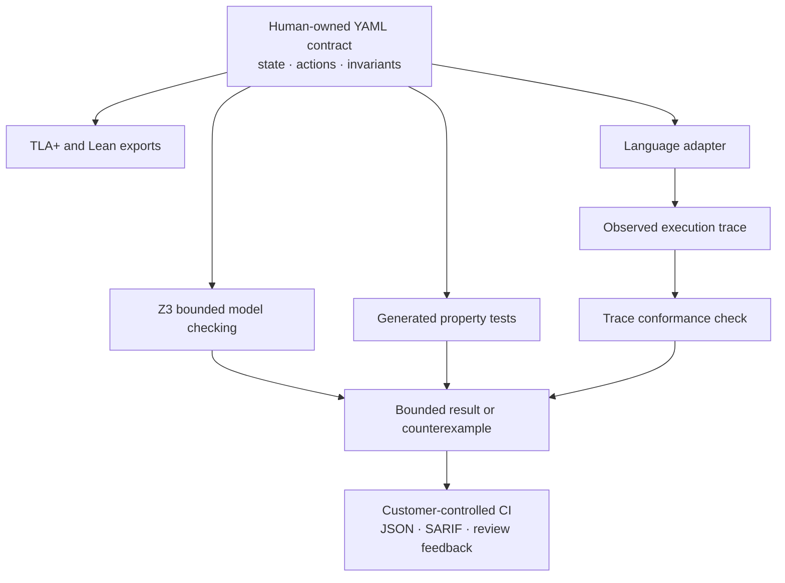

# VeriSpec

**One formal spec. One contract. A counterexample instead of "the test failed".**

[](https://github.com/verispec/verispec/actions/workflows/ci.yml)
[](https://www.python.org/)
[](LICENSE)

[Quick start](#try-it-in-two-minutes) · [Feature tour](docs/feature-tour.md) · [Spec format](docs/spec-format.md)
[Guarantees](docs/guarantees.md) · [CI](docs/ci.md) · [Language integrations](docs/language-integrations.md)

VeriSpec turns a human-owned YAML spec (a state machine with invariants) into
everything a team needs to keep an implementation honest, in any language:

| From the same spec | What you get |
| --- | --- |
| Z3 bounded model checking | A concrete counterexample, step by step |
| TLA+ and Lean exports | The design, stated for other verification tools |
| Generated property tests | Hypothesis, fast-check, rapid, proptest, jqwik |
| Trace conformance | A check that your real code follows the contract |
| An agent brief and an MCP server | Structured feedback for coding agents |

The spec belongs to a human. Agents read it; they never edit it to make a
check pass.



## Try it in two minutes

```bash
git clone https://github.com/verispec/verispec.git
cd verispec
pip install -e ".[test]"

verispec validate examples/bank.yaml
# OK: spec Bank valid (2 vars, 2 actions, 2 invariants)

verispec check examples/bank.yaml --bound 10
# no violation up to bound 10  (bounded claim only, not a proof for all depths; guarantee: bounded-proved(10))

verispec check examples/bank-buggy.yaml --bound 10
# COUNTEREXAMPLE found within bound 2: invariant(s) violated: non_negative
#   step 0: state={'balance_a': 50, 'balance_b': 50}
#     -> action transfer_a_to_b params={'amount': 1}
#   step 1: state={'balance_a': 49, 'balance_b': 51}
#     -> action transfer_a_to_b params={'amount': 50}
#   step 2: state={'balance_a': -1, 'balance_b': 101}
#   violated at step 2: non_negative (invariant) balance_a >= 0 and balance_b >= 0
```

That is the whole demo: a spec, a broken implementation, and the exact
sequence of two transfers that breaks the contract.

For concurrent clients, declare actors in the spec and run interleaving search:

```bash
verispec check-concurrent examples/bank-concurrent-race.yaml --bound 6
```

## Start from a template

```bash
verispec init my-service --template ledger --lang python
# wrote my-service/ledger.verispec.yaml
# wrote my-service/adapter_ledger.py
# wrote my-service/README.md
```

Templates: `ledger`, `idempotency`, `order`, `rate-limiter`, `queue`.

## A real example: a REST API with a database

[`examples/orders-api/`](examples/orders-api/) is a complete orders API with
inventory, payments and shipments, and the business rules that go with it:
you cannot oversell, a payment is applied at most once, the revenue is what
the paid orders are worth.

**One spec, three implementations, one behaviour.** The contract
(`orders.verispec.yaml`) is written once; the API is implemented in Python
(FastAPI + SQLite), TypeScript (`node:http` + `node:sqlite`) and Go
(`net/http` + SQLite). Each implementation has a three-method adapter, the
generated conformance test drives all of them against the same contract, and
the recorded traces prove they agree with each other.

```console
$ verispec check examples/orders-api/orders.verispec.yaml --bound 6
no violation up to bound 6  (bounded claim only, not a proof for all depths; guarantee: bounded-proved(6))

$ verispec check-trace examples/orders-api/orders.verispec.yaml examples/orders-api/traces/orders-session.json
trace OK: 8 steps conform to spec OrdersApi

$ verispec diff-trace examples/orders-api/traces/orders-session.json \
                    examples/orders-api/traces/orders-session-typescript.json
the two traces are identical (8 steps)
```

The walkthrough is in [`examples/orders-api/README.md`](examples/orders-api/README.md).

The smaller examples live next to it: [`examples/`](examples/) has a bank
(conservation), a ledger (maps and sets), an idempotency service, an order
state machine, a rate limiter and a queue, each with a buggy variant that
the checker catches.

## The spec

```yaml
spec_version: "1.0"
name: Bank
description: Two accounts. Transfers conserve the total and never go negative.
vars:
  balance_a: {type: int, min: 0, max: 100}
  balance_b: {type: int, min: 0, max: 100}
init:
  balance_a: "50"
  balance_b: "50"
actions:
  - name: transfer_a_to_b
    params:
      amount: {type: int, min: 1, max: 50}
    requires: ["amount > 0", "balance_a >= amount"]
    effects:
      balance_a: "balance_a - amount"
      balance_b: "balance_b + amount"
invariants:
  - {name: total_conserved, expr: "balance_a + balance_b == 100"}
  - {name: non_negative, expr: "balance_a >= 0 and balance_b >= 0"}
```

The v1 format also has bounded collections (`map`, `set`, `seq`), records,
modules (`imports`) and a `spec_version`. The full reference is in
[`docs/spec-format.md`](docs/spec-format.md).

## Check your implementation

An adapter is three methods in any language:

```python
class BankAdapter:
    def reset(self): ...
    def apply(self, action, **params): ...
    def snapshot(self) -> dict: ...   # exactly the spec's state variables
```

Then:

```bash
verispec gen-tests specs/bank.verispec.yaml --lang python -o tests/test_bank_verispec.py
verispec gen-tests specs/bank.verispec.yaml --lang typescript -o src/bank.verispec.test.ts
verispec gen-tests specs/bank.verispec.yaml --lang go -o bank/bank_verispec_test.go
```

Or replay a trace recorded by your real code:

```bash
verispec check-trace specs/bank.verispec.yaml traces/production.json
# step 42: effect mismatch for action transfer_a_to_b: expected {...}, got {...}
```

For OpenTelemetry or structured logs, map telemetry to steps and check online
([`docs/runtime-observe.md`](docs/runtime-observe.md)):

```bash
verispec observe-runtime --spec examples/bank.yaml \
  --mapping examples/runtime-observe/bank-mapping.yaml \
  --input examples/runtime-observe/bank-otlp.json
```

## CI

The GitHub Action checks the spec and your traces, uploads SARIF for code
scanning, publishes the HTML report, and comments the pull request with the
counterexample:

```yaml
- uses: verispec/verispec@v1
  with:
    spec: specs/bank.verispec.yaml
    traces: traces/bank.json
    bound: 10
```

The same job is available as a Docker image
(`docker run --rm -v "$PWD:/work" -w /work verispec check specs/bank.verispec.yaml`),
and the CLI's exit codes and `--format json` output work in any pipeline.

The spec is human owned: when a pull request changes the spec or an
imported dependency, the Action requires the configured approval label and a
non-author human approval review on the current PR head. See
[the CI guide](docs/ci.md) for the permissions and race checks.

## Escalating verification and spec-strength diagnostics

Two optional workflows port *ideas* from recent agent-evaluation papers into
VeriSpec’s formal setting (no ML training, no LLM in the core):

**Escalating verification loop** ([VeriCUA](https://arxiv.org/abs/2610.26469)):
each invariant (and optional trace conformance) is a check with tri-state status
`satisfied` / `violated` / `unresolved`. Cheap evidence runs first (trace replay
and bounded random walks, like generated property tests); still-unresolved checks
escalate to Z3 with a larger bound (default **K=2** rounds). The loop stops at
the first counterexample. Reports name the condition and where evidence lives
(state variables, trace step) and record cost (rounds, backend calls, time).

```bash
verispec verify-loop examples/bank.yaml --trace examples/traces/bank-valid.json
verispec verify-loop examples/bank-buggy.yaml --rounds 2 --format json
```

**Spec-strength / vacuity** ([StepBench](https://arxiv.org/abs/2610.26679)):
from a known-good trace (or a model-generated walk), build mutants that omit a
recorded step, swap two steps, or replace an action while keeping the wrong
state. Mutants the spec still accepts are reported as *survived* (the contract
may be too weak). Caught mutants get a typed failure label (`missing_step`,
`misordered_step`, `extraneous_step`, `invariant_contradiction`).

```bash
verispec spec-strength examples/bank.yaml --trace examples/traces/bank-valid.json
```

**Coverage and drift.** `verispec coverage` summarises which parts of the spec
were exercised by traces (and optional test-event recordings), with
`--fail-under` for CI. `verispec drift` compares a git range to per-action
`implements` mappings and warns when code and contract move independently. The
GitHub Action accepts `drift-check: true` for PR annotations.

Not ported: RL fine-tuning, LLM judges, or GUI automation from those papers—only
the verification-loop and perturbation-diagnosis patterns, adapted to YAML specs,
Z3, and trace conformance.

## What VeriSpec does not claim

VeriSpec labels every result with the guarantee it carries:

| Label | Meaning |
| --- | --- |
| `bounded-proved(k)` | No invariant was violated in any execution up to depth *k*. A bounded claim, never a proof for all depths. |
| `conformance-tested` | A recorded trace of the real implementation was replayed and every step conformed. |
| `signature-verified` | The spec still matches the digest a human approved. |
| `violation-found` | A concrete counterexample exists. |
| `unknown` | The checker could not decide. Treat it as inconclusive. |

Digest-only signature verification detects changes but does not
cryptographically authenticate the approver. When identity matters, sign with
GPG and verify with `--require-cryptographic`; see
[the guarantee details](docs/guarantees.md).

A spec that cannot fail is a spec that proves nothing, so `verispec lint`
reports tautological invariants, actions that can never be enabled, and
actions that change nothing.

## Languages

| Language | Generated tests | Trace recorder | Status |
| --- | --- | --- | --- |
| Python | Hypothesis | yes (`verispec.sdk`) | supported |
| TypeScript | fast-check | yes (`@verispec/adapter`) | supported |
| JavaScript | fast-check | yes (`@verispec/adapter`) | supported |
| Go | standard library generator | yes | supported |
| Rust | built-in generator, no external crate | yes | supported |
| C / C++ | C harness (scalar specs) | yes | supported |
| Java / Kotlin | jqwik templates | yes | supported (templates) |

The adapter contract is tiny on purpose: an adapter is a *test* of your
implementation, not a formal semantics of your language. That is why a new
language takes days, not months.

## Agents

```bash
verispec mcp     # MCP server on stdio
```

The server exposes `verify` (check a spec, optionally replay a trace, return a
structured counterexample), `describe_spec` and `list_invariants`.
`verispec brief specs/bank.verispec.yaml` writes the brief you hand to a
coding agent, with the read-only rule at the top.

## Documentation

| Document | What is in it |
| --- | --- |
| [`docs/feature-tour.md`](docs/feature-tour.md) | Examples across the CLI and integration features |
| [`docs/spec-format.md`](docs/spec-format.md) | The v1 format reference |
| [`docs/tutorial-15min.md`](docs/tutorial-15min.md) | From zero to a counterexample |
| [`docs/ci.md`](docs/ci.md) | GitHub Actions: the action, the recipes, the release |
| [`docs/language-integrations.md`](docs/language-integrations.md) | Per-language recipes |
| [`docs/adapter-authoring.md`](docs/adapter-authoring.md) | How to write an adapter |
| [`docs/guarantees.md`](docs/guarantees.md) | What each guarantee means |
| [`docs/agent-integration.md`](docs/agent-integration.md) | The MCP server and the brief |
| [`docs/adrs/`](docs/adrs/) | The decisions, with their reasons |
| [`rfcs/`](rfcs/) | The spec format change process |

## Project status

VeriSpec is an Apache-2.0 local verification toolkit for customer-controlled
CI—not a hosted verification service. Run the CLI locally or in your own
pipeline; the optional GitHub Action uses only the permissions granted to that
workflow. Language support and implementation maturity are listed in
[Language integrations](docs/language-integrations.md).

The v1 format, bounded checker, trace checking, signing, report generation,
and CI integrations are part of this repository. External Kani and ESBMC
harnesses are starting points that you connect to your implementation; they
are not turnkey proofs. The core stays in Python until a documented trigger
says otherwise ([ADR-0001](docs/adrs/README.md)).

## Contributing

Specs, adapters, documentation and the format itself are all open to
contributions. Start with [`CONTRIBUTING.md`](CONTRIBUTING.md); format changes
go through the RFC process in [`rfcs/`](rfcs/).

## License

Apache-2.0. See [`LICENSE`](LICENSE).
