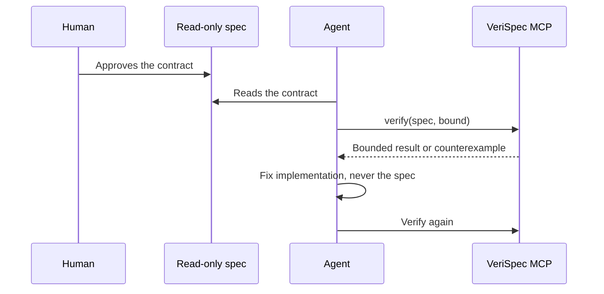

# Agent integration

A coding agent can work against a VeriSpec spec. The spec is the contract; the
agent reads it, implements it, and gets a structured counterexample back when
it breaks it.

The rule that makes this work: **the spec is human owned and read-only for
agents.** The agent never edits the spec to make a test pass. When the
contract and the code disagree, the code is what changes.



- [The three tools](#the-three-tools)
- [Running the server](#running-the-server)
- [The MCP tools](#the-mcp-tools)
- [The counterexample is the feedback signal](#the-counterexample-is-the-feedback-signal)
- [The agent brief](#the-agent-brief)
- [The read-only policy](#the-read-only-policy)
- [Wiring the server into an agent](#wiring-the-server-into-an-agent)
- [A complete agent loop](#a-complete-agent-loop)

---

## The three tools

VeriSpec exposes three tools to an agent over the Model Context Protocol:

| Tool | What it does |
| --- | --- |
| `verify` | Check a spec, and optionally a trace. Returns a structured counterexample when an invariant can be violated. |
| `describe_spec` | Summarise the contract: state variables, actions, invariants. |
| `list_invariants` | List the invariants with their expressions. |

The counterexample is the point. An agent that breaks the contract gets a
concrete, reproducible failure instead of "the test failed".

## Running the server

```console
$ verispec mcp
```

The server speaks JSON-RPC 2.0 on stdin and stdout, one JSON object per line.
It implements the `initialize`, `tools/list`, `tools/call` and `ping` methods.

A hand-written exchange looks like this:

```console
$ echo '{"jsonrpc":"2.0","id":1,"method":"initialize","params":{}}' | verispec mcp
{"jsonrpc": "2.0", "id": 1, "result": {"protocolVersion": "2024-11-05", "capabilities": {"tools": {"listChanged": false}}, "serverInfo": {"name": "verispec", "version": "1.0.0"}}}
```

The protocol version is `2024-11-05`.

## The MCP tools

### `verify`

| Parameter | Type | Required | Meaning |
| --- | --- | --- | --- |
| `spec_path` | string | yes | Path to the spec file. |
| `bound` | integer | no | Maximum number of steps. Default 10. |
| `trace_path` | string | no | A JSON trace of a real implementation to replay. |
| `invariant` | string | no | Restrict the search to one invariant. |

The response is a JSON document:

```json
{
  "spec": "Bank",
  "spec_digest": "sha256:9ea79b7f4594b565115ae8f0a5605efe7c7f526005424f2931c9941239b16b29",
  "status": "violation",
  "guarantee": "violation-found",
  "bound": 2,
  "message": "COUNTEREXAMPLE found within bound 2: invariant(s) violated: non_negative",
  "violations": [
    {
      "name": "non_negative",
      "kind": "invariant",
      "expr": "balance_a >= 0 and balance_b >= 0",
      "step": 2,
      "state": {"balance_a": -1, "balance_b": 101}
    }
  ],
  "trace": [
    {"step": 0, "state": {"balance_a": 50, "balance_b": 50}, "action": "transfer_a_to_b", "params": {"amount": 1}},
    {"step": 1, "state": {"balance_a": 49, "balance_b": 51}, "action": "transfer_a_to_b", "params": {"amount": 50}},
    {"step": 2, "state": {"balance_a": -1, "balance_b": 101}}
  ],
  "guidance": "This is a ground truth counterexample: reproduce it, fix the implementation and re-run. Never weaken the spec or the invariant to make it pass."
}
```

When a `trace_path` is given, the response also carries a `trace_check` block
with the reason, the failed step, and the expected and observed states.

The `isError` flag of the MCP result is `true` when a violation was found, so
an agent that checks the flag sees the failure without parsing the text.

### `describe_spec`

```json
{
  "name": "Bank",
  "description": "Two accounts A and B...",
  "spec_version": "1.0",
  "spec_digest": "sha256:9b267ba92b5b4c91e8286fed866b4cca1f029ce93734456685f07c82f71b84f1",
  "state": {
    "balance_a": {"type": "int", "description": "int[0..100]", "min": 0, "max": 100, "values": null},
    "balance_b": {"type": "int", "description": "int[0..100]", "min": 0, "max": 100, "values": null}
  },
  "actions": [
    {
      "name": "transfer_a_to_b",
      "params": {"amount": "int"},
      "requires": ["amount > 0", "balance_a >= amount"],
      "effects": {"balance_a": "balance_a - amount", "balance_b": "balance_b + amount"}
    }
  ],
  "invariants": [
    {"name": "total_conserved", "expr": "balance_a + balance_b == 100"},
    {"name": "non_negative", "expr": "balance_a >= 0 and balance_b >= 0"}
  ],
  "note": "The spec is human owned and read-only for agents."
}
```

This is the compact, machine-readable form of the contract. It is what an
agent should read before it writes any code.

### `list_invariants`

```json
{
  "spec": "Bank",
  "invariants": [
    {"name": "total_conserved", "expr": "balance_a + balance_b == 100", "guarantee": "not-checked"},
    {"name": "non_negative", "expr": "balance_a >= 0 and balance_b >= 0", "guarantee": "not-checked"}
  ],
  "note": "Listing invariants does not run the checker or establish a guarantee."
}
```

The `not-checked` marker is deliberate: `list_invariants` describes the
contract but does not prove the invariants. Call `verify` to run the checker.
See [Guarantees](guarantees.md) for the scope of each verification result.

## The counterexample is the feedback signal

A counterexample is a **recipe**, not an error message. Each step names the
action and the parameters:

```json
{"step": 0, "action": "transfer_a_to_b", "params": {"amount": 1}, "state": {"balance_a": 50, "balance_b": 50}}
{"step": 1, "action": "transfer_a_to_b", "params": {"amount": 50}, "state": {"balance_a": 49, "balance_b": 51}}
{"step": 2, "state": {"balance_a": -1, "balance_b": 101}}
```

An agent that gets this back should:

1. **Reproduce it.** Apply exactly those actions with exactly those
   parameters. The bug is real if the state matches.
2. **Find the defect.** The state after step 2 is wrong: `balance_a` is
   `-1`. The action that produced it is the one to look at.
3. **Fix the code, not the contract.** The invariant `non_negative` said
   what it always said. Editing the spec to remove it would hide the defect
   from every future reader.
4. **Re-run.** Call `verify` again. If the checker decides every depth through the requested bound, report `bounded-proved(k)`; if it returns `unknown`, report the result as inconclusive.

The `guidance` field in the response says the same thing in one line, and it
is there so the agent reads it.

### Giving the counterexample back to the agent

There are two ways, and they compose.

**Through the MCP server.** Call `verify` with the spec path and the bound.
The response is already the structured counterexample, in the shape above.

**Through the CLI.** The same information, for agents that can only run
commands:

```console
$ verispec check specs/bank.yaml --bound 10 --format json > /tmp/counterexample.json
```

The JSON payload has the same fields as the MCP response: `status`,
`guarantee`, `bound`, `message`, `violations` and `trace`. The human-readable
form is:

```console
$ verispec check specs/bank.yaml --bound 10
COUNTEREXAMPLE found within bound 2: invariant(s) violated: non_negative
  step 0: state={'balance_a': 50, 'balance_b': 50}
    -> action transfer_a_to_b params={'amount': 1}
  step 1: state={'balance_a': 49, 'balance_b': 51}
    -> action transfer_a_to_b params={'amount': 50}
  step 2: state={'balance_a': -1, 'balance_b': 101}
  violated at step 2: non_negative (invariant) balance_a >= 0 and balance_b >= 0
  This is a counterexample: reproduce it, fix the implementation, re-run. Do not weaken the spec.
```

And there is a page for a human, and for the agent to read if it can open
one:

```console
$ verispec view specs/bank.yaml -o counterexample.html --bound 10
wrote counterexample view to counterexample.html
```

The three routes carry the same evidence. Use the JSON when the agent parses,
the text when the agent reads logs, and the HTML when a human reviews it.

## The agent brief

The brief is the markdown document meant to be pasted into an agent's
context. It states the contract in a form the agent cannot misread, and it
says, out loud, that the spec is read-only.

```console
$ verispec brief specs/bank.yaml -o brief.md
wrote brief to brief.md
```

It contains:

- the header **SPEC IS READ-ONLY. Do not modify the spec to make tests pass.**
- the context and the format version,
- the state variables with their types and bounds,
- every action, with its parameters, its preconditions and its effects,
- every invariant, as a MUST rule,
- the adapter contract,
- the counterexample etiquette.

The invariants section is the important one:

```markdown
## Invariants - MUST / NEVER rules
- MUST always hold - **total_conserved**: `balance_a + balance_b == 100`
- MUST always hold - **non_negative**: `balance_a >= 0 and balance_b >= 0`
```

And the etiquette section is what keeps an agent from "fixing" a red build
by editing the contract:

```markdown
## Counterexample etiquette
- A counterexample from `verispec check` / `check-trace` is ground truth about a
  spec violation: reproduce it, fix the implementation, re-run until green.
- Never weaken an invariant, precondition, or generated test to silence it.
- Bounded checking says "no violation up to bound K" - never claim "proven for all depths".
- The spec is owned by a human.  If you need to change it, ask.
```

The brief is regenerated from the spec, so it never goes stale:

```console
$ verispec brief specs/bank.yaml -o brief.md
```

Commit the brief, or generate it in CI and attach it to the pull request. Do
not hand-edit it: it is derived from a human-owned artifact, and an
out-of-date brief is a lie about the contract.

## The read-only policy

The spec belongs to a human. Concretely:

| Rule | Why |
| --- | --- |
| An agent never edits the spec. | The spec is the contract. An agent that edits it can make any test pass. |
| An agent never edits an invariant, a precondition or a bound. | That is the same thing as editing the spec, with extra steps. |
| An agent reports a suspected spec defect and stops. | Only a human can decide whether the contract or the code is wrong. |
| If your policy requires signatures, check them in CI. | A digest detects later changes; require a cryptographic signature when approver identity must be authenticated. |
| A pull request that changes the spec needs the configured label and a non-author human approval on the current PR head. | Stale approvals and label-only approval do not pass the gate. |

The mechanism is described in [`docs/ci.md`](ci.md). The digest is:

```console
$ verispec sign specs/bank.yaml --approver alice --note "reviewed"
signed Bank (sha256:9b267ba92b5b4c91e8286fed866b4cca1f029ce93734456685f07c82f71b84f1)
signature written to specs/bank.yaml.signature.json
```

## Wiring the server into an agent

The server is a stdio MCP server, so any MCP client can launch it. The
configuration is the usual one:

```json
{
  "mcpServers": {
    "verispec": {
      "command": "verispec",
      "args": ["mcp"],
      "env": {}
    }
  }
}
```

If the client wants the absolute path to the tool:

```json
{
  "mcpServers": {
    "verispec": {
      "command": "/usr/local/bin/verispec",
      "args": ["mcp"]
    }
  }
}
```

The server needs the spec to be readable from the working directory the agent
runs in. `spec_path` is resolved relative to the server's working directory,
so an absolute path is the safest thing to pass.

## A complete agent loop

The loop an agent should follow, and the commands it runs:

```console
# 1. Read the contract.
$ verispec brief specs/bank.yaml
#    Or, through MCP: describe_spec / list_invariants

# 2. Implement against the contract.  Do not touch the spec.

# 3. Check the contract against the model.
$ verispec check specs/bank.yaml --bound 10
#    Or, through MCP: verify

# 4. If a counterexample came back, reproduce it, fix the code, and go to 3.
#    If the trace of the real implementation does not conform:
$ verispec check-trace specs/bank.yaml traces/bank.json

# 5. Report the result honestly.
```

Step 5 matters. The result of a check is a **bounded** claim. The agent
should say "no invariant was violated up to bound 10", not "the spec is
proved". The label in the output is the contract for what the agent may
claim, and the labels are defined in [`docs/guarantees.md`](guarantees.md).

The one thing the agent must never do is edit the spec to make step 3 green.
The `guidance` field of the `verify` response, the brief's etiquette section,
and the CI approval gate all say the same thing, in three different places,
because it is the one rule that matters.
