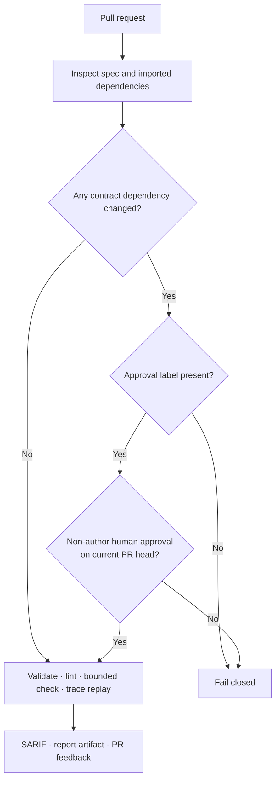

# VeriSpec in CI

Keep the contract close to the code: run VeriSpec in your own pipeline, on
customer-controlled runners, and make every result visible to reviewers. The
recommended GitHub Action checks specs and traces, uploads SARIF, publishes a
report artifact, and comments on pull requests.

[Commands](#what-to-run) · [GitHub Action](#recommended-github-actions-setup) · [Spec approval](#human-approval-for-spec-changes) · [Direct CLI](#using-the-cli-directly) · [Releases](#releasing) · [Troubleshooting](#when-a-check-fails)

## CI at a glance



The approval gate applies to pull requests that change the entry spec or any
spec it imports. A label alone is not approval: the Action also checks for a
non-author human review on the current PR head and rejects stale refs.

## What to run

| Command | What it checks | Typical exit |
| --- | --- | --- |
| `verispec validate <spec>` | The spec parses and type-checks. | `0` or `2` |
| `verispec lint <spec>` | The spec is not obviously vacuous. | `0` or `1` |
| `verispec check <spec> --bound N` | No invariant is violated up to depth *N*. | `0` or `1` |
| `verispec check-trace <spec> <trace.json>` | A recorded implementation run conforms. | `0` or `1` |
| `verispec verify-signature <spec>` | The spec still matches its approved digest. | `0` or `1` |
| `verispec report <spec> -o report.html` | A readable conformance report. | `0` or `1` |
| `verispec view <spec> -o counterexample.html` | A counterexample page. | `0` or `1` |

For machine-readable output, use `--format json` or `--format sarif`:

```console
$ verispec check specs/bank.yaml --bound 10 --format json
$ verispec check specs/bank.yaml --bound 10 --format sarif > verispec.sarif
```

JSON is suitable for pipeline decisions and custom tooling. SARIF 2.1.0 can
be uploaded to GitHub code scanning or another compatible viewer.

## Exit codes

| Code | Meaning | Pipeline response |
| --- | --- | --- |
| `0` | The requested check passed. | Continue. |
| `1` | A violation was found, a trace did not conform, or the solver returned `unknown`. | Fail the job; unknown is inconclusive, not green. |
| `2` | The spec or trace is invalid. | Fail the job and correct the input. |
| `3` | VeriSpec encountered a tooling error. | Fail the job and report a tool issue with the command and output. |

When you want to upload SARIF even if a violation is found, preserve the
checker exit code rather than swallowing it with `|| true`:

```yaml
- name: Model check
  id: model-check
  shell: bash
  run: |
    status=0
    verispec check specs/bank.yaml --bound 10 --format sarif > verispec.sarif || status=$?
    echo "exit_code=$status" >> "$GITHUB_OUTPUT"
    exit "$status"

- name: Upload SARIF
  if: always()
  uses: github/codeql-action/upload-sarif@v3
  with:
    sarif_file: verispec.sarif
```

The check step still fails the job when appropriate; the upload step runs to
publish the result. Do not make the final verification step green with
`|| true`.

## Recommended GitHub Actions setup

The composite Action is the simplest way to get the full workflow. Save this
as `.github/workflows/verispec.yml` and adjust the spec and trace paths:

```yaml
name: verispec

on:
  pull_request:
  push:
    branches: [main]
  workflow_dispatch:

permissions:
  contents: read
  pull-requests: write
  security-events: write

jobs:
  verify:
    runs-on: ubuntu-latest
    steps:
      - uses: actions/checkout@v4

      - uses: verispec/verispec@v1
        with:
          spec: specs/bank.yaml
          traces: traces/bank.json
          bound: "10"
          require-spec-approval: "true"
          approval-label: spec-approved
```

The Action validates and checks the spec, replays the requested traces,
uploads SARIF, publishes an HTML report as an artifact, and comments the PR
with the result. It fails the job when verification fails. Pin the Action to a
reviewed full commit SHA in security-sensitive workflows.

| Input | Purpose | Default |
| --- | --- | --- |
| `spec` | Spec to check. Required. | — |
| `traces` | Comma-separated JSON traces to replay. | Empty |
| `bound` | Maximum model-checking depth. | `10` |
| `timeout-ms` | Solver timeout per bound. | `30000` |
| `python-version` | Python used to run VeriSpec. | `3.11` |
| `version` | VeriSpec version to install instead of the bundled package. | Empty |
| `comment` | Comment on pull requests with the result. | `true` |
| `report` | Publish the HTML report as an artifact. | `true` |
| `require-spec-approval` | Require approval for changed spec dependencies. | `true` |
| `approval-label` | Label required for an approved spec change. | `spec-approved` |

For pull requests, approval enforcement needs `pull-requests: read`; use
`pull-requests: write` when PR comments are enabled. SARIF upload needs
`security-events: write`. GitHub may restrict write permissions for forked
pull requests according to repository settings.

The approval gate follows imports from the configured entry spec and fails
closed if it cannot inspect them. If a spec dependency changes while the job
is running, the Action asks you to rerun the check against the latest PR refs.

## Using the CLI directly

The CLI works in any CI provider. This example runs checks in a customer-owned
runner:

```yaml
- uses: actions/checkout@v4
- uses: actions/setup-python@v5
  with:
    python-version: "3.11"
- run: python -m pip install -e ".[test]"
- run: verispec validate specs/bank.yaml
- run: verispec lint specs/bank.yaml
- run: verispec check specs/bank.yaml --bound 10
- run: verispec check-trace specs/bank.yaml traces/bank.json
```

This CLI-only example does **not** implement the spec-change approval gate.
Use the composite Action above, or add an equivalent reviewed gate, when your
repository requires human approval for contract changes. The CLI exit codes
and JSON/SARIF formats are stable interfaces for other pipeline systems.

## Human approval for spec changes

**The spec is human owned.** A pull request that changes the contract should
receive deliberate human review. VeriSpec's Action can enforce a configured
label plus a non-author approval review on the current PR head. Configure
`CODEOWNERS` as well to request the right reviewers automatically; CODEOWNERS
requests review but does not itself prove that the current spec was approved.

A signature can record the digest a human approved:

```console
$ verispec sign specs/bank.yaml --approver alice --note "reviewed"
signed Bank (sha256:…)
signature written to specs/bank.yaml.signature.json
  No cryptographic signature: the approver is a recorded claim.

$ verispec verify-signature specs/bank.yaml
OK: spec matches its approved digest (approver: alice). No cryptographic signature: the approver is a recorded claim, not proof.
```

The digest covers the resolved spec, including imported files, so a change to
an imported dependency invalidates the signature. Digest-only verification
detects drift; it does not authenticate the approver. Where cryptographic
identity is required, sign with GPG and verify with
`verispec verify-signature specs/bank.yaml --require-cryptographic`. Keep the
private key out of the repository and make it available to CI through your
organization's approved secret-management process.

## Releasing

The release workflow is configured to run when a version tag is pushed. It
builds the Python and npm distributions, publishes them, and creates a GitHub
release:

```console
$ git tag v1.0.1 && git push origin v1.0.1
```

| Job | Responsibility |
| --- | --- |
| `build` | Build and check the Python distribution and npm package; upload artifacts. |
| `publish-pypi` | Publish to PyPI using trusted publishing (`id-token: write`). |
| `publish-npm` | Publish `@verispec/adapter`; requires an `NPM_TOKEN` secret in the `npm` environment. |
| `release` | Create the GitHub release with generated notes and attached artifacts. |

The npm package lives in `adapters/typescript/`; both packages use the same
tag. Validate packaging and publishing credentials in the release environment
before cutting a production release.

## When a check fails

| Result | What to do |
| --- | --- |
| `check` finds a counterexample | Reproduce it and fix the implementation. Do not weaken the spec to make CI green. |
| `check` returns `unknown` | Treat it as inconclusive. Raise the timeout, narrow the check, or investigate the model; do not report it as proved. |
| `check-trace` rejects a run | Fix the implementation or correct a faulty trace recorder. |
| `verify-signature` reports a mismatch | Have a human review the change and sign the new resolved spec. |
| Exit `2` | Correct the invalid spec or trace, with human review for contract changes. |
| Exit `3` | Report a VeriSpec defect with the exact command, version, and output. |
| Suspected false positive | Follow the [false-positive policy](guarantees.md#the-false-positive-policy); never edit the spec to hide it. |
