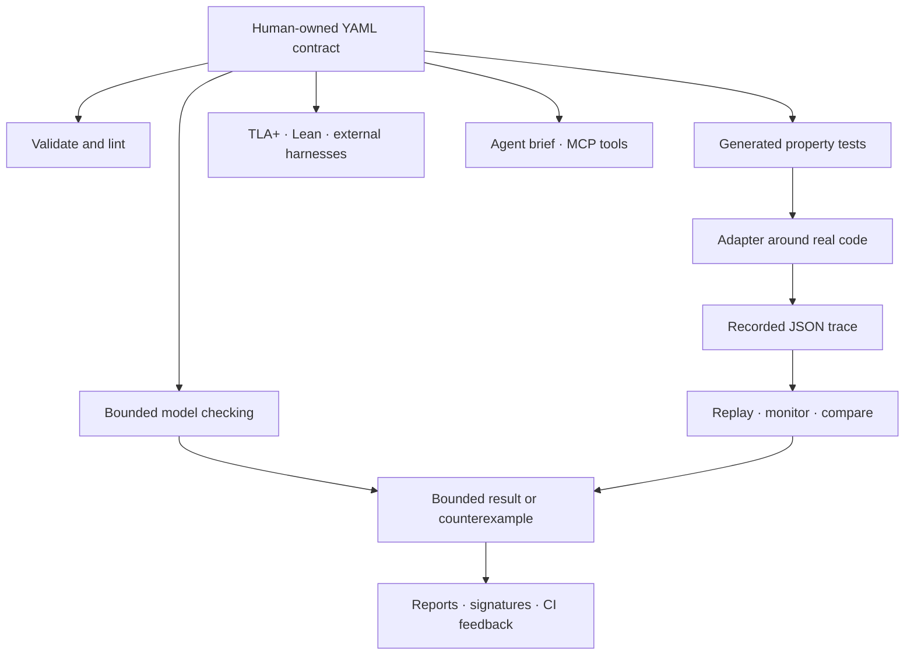

# VeriSpec feature tour

One human-owned spec can drive model checking, generated tests, trace replay,
exports, reports, signatures, and CI. This tour maps each capability to a
small command, snippet, or repository example. Run commands from the
repository root after installing VeriSpec; paths under `/tmp` are disposable
outputs.

[Start here](#1-scaffold-and-validate) · [Model checking](#3-find-model-violations) · [Test and trace the implementation](#4-check-real-code) · [Exports](#5-export-to-other-checkers) · [Reports and signatures](#6-review-and-attest-results) · [Agents and CI](#7-connect-agents-and-ci)



## 1. Scaffold and validate

Check the installed version, create a starter project, and validate the
contract before checking it:

```bash
verispec version
verispec init /tmp/my-ledger --template ledger --lang python
verispec validate /tmp/my-ledger/ledger.verispec.yaml
verispec lint /tmp/my-ledger/ledger.verispec.yaml
```

`init` writes the new spec, adapter scaffold, and a short README into the
chosen directory; use a fresh path because it skips existing files by default.
`validate` checks syntax and types; `lint` looks for specs that cannot
meaningfully fail.

Available templates include `ledger`, `idempotency`, `order`, `rate-limiter`,
and `queue`. For older v0.1 specs, `migrate` writes the converted v1 YAML to
standard output by default. Review it before using `--in-place`:

```bash
verispec migrate examples/link-queue.yaml > /tmp/link-queue.v1.yaml
verispec validate /tmp/link-queue.v1.yaml
```

## 2. Model state and compose specs

The v1 format supports scalars, enums, bounded maps and sets, sequences, and
records. [`corpus/collections/spec.yaml`](../corpus/collections/spec.yaml)
shows all collection shapes in one spec; here is a shortened excerpt:

```yaml
vars:
  balances: {type: map, key: int, key_min: 0, key_max: 3, value: int, value_min: 0, value_max: 1000, max_size: 4}
  seen: {type: set, of: str, elem_domain: [a, b, c], max_size: 3}
  history: {type: seq, of: int, elem_min: 0, elem_max: 10, max_size: 4}
  customer: {type: record, fields: {name: str, tier: "enum[gold,silver]", active: bool}}
```

Specs can import self-contained modules. The path is relative to the importing
file; imported names are prefixed with the alias (for example, `counter_value`):

```yaml
imports:
  - path: ./lib/counter.yaml
    as: counter
    version: "^1.0"
```

Resolve and inspect the dependency graph, write a digest lock file, or check
that a lock still matches. Replace the example path with your importing spec:

```bash
verispec deps specs/service.yaml
verispec deps specs/service.yaml --lock /tmp/service.verispec.lock
verispec deps specs/service.yaml --check-lock /tmp/service.verispec.lock
```

See the [spec-format reference](spec-format.md) for merge rules, expression
syntax, bounds, and the full import contract.

## 3. Find model violations

The checker explores the spec—not a particular implementation—and returns a
short counterexample when an invariant can be violated:

```console
$ verispec check examples/bank.yaml --bound 10
no violation up to bound 10  (bounded claim only, not a proof for all depths; guarantee: bounded-proved(10))

$ verispec check examples/bank-buggy.yaml --bound 10
COUNTEREXAMPLE found within bound 2: invariant(s) violated: non_negative
```

Use `--invariant NAME` to focus a check, `--timeout MS` to set the solver
timeout per bound, and `--format json` or `--format sarif` for automation.
A solver `unknown` is inconclusive and fails closed; a bounded result is never
a proof for all execution depths. Read [Guarantees](guarantees.md) before
summarizing results as evidence.

## 4. Check real code

### Generate property tests

An adapter exposes `reset`, `apply`, and `snapshot`; generated tests compare
the implementation with the spec. The language integration guide has the
adapter contract and recipes for each supported generator:

```bash
verispec gen-tests examples/bank.yaml --lang python -o /tmp/test_bank_verispec.py
VERISPEC_ADAPTER=bank_adapter:BankAdapter PYTHONPATH=examples \
  pytest -q /tmp/test_bank_verispec.py
```

The CLI generators cover Python, TypeScript, JavaScript, Go, Rust, and C.
Java has templates, but its `gen-tests` CLI generator is not wired yet. See
[Language integrations](language-integrations.md) for per-language details.

### Record a trace from Python

The Python SDK records the implementation's actual snapshots as actions run:

```python
from verispec.model import load_spec
from verispec.sdk import TraceRecorder
from bank_adapter import BankAdapter

spec = load_spec("examples/bank.yaml")
recorder = TraceRecorder(spec, adapter=BankAdapter())
recorder.reset()
recorder.apply("transfer_a_to_b", amount=20)
recorder.write("/tmp/bank-trace.json")
```

Run this from the repository root with `PYTHONPATH=examples`; then replay the
trace with `verispec check-trace examples/bank.yaml /tmp/bank-trace.json`.
Other language adapters can use their recorder or write the same JSON trace
format directly.

### Replay, compare, and monitor traces

A trace records the implementation's observed states. Replay checks each step
against the spec; a passing trace is evidence about that run only:

```bash
verispec check-trace examples/bank.yaml examples/traces/bank-valid.json
```

Compare traces from two implementations to find behavioral drift:

```console
$ verispec diff-trace \
    examples/orders-api/traces/orders-session.json \
    examples/orders-api/traces/orders-session-typescript.json
the two traces are identical (8 steps)
```

Monitor an existing trace, or watch a file as new steps are appended:

```bash
verispec monitor examples/traces/bank-valid.json --spec examples/bank.yaml
verispec monitor /var/log/service-trace.json --spec specs/service.yaml \
  --follow --interval 1.0
```

See the [orders API example](../examples/orders-api/README.md) for three
implementations checked against one contract.

## 5. Export to other checkers

Generate TLA+ and Lean artifacts, run TLC when it is installed, or generate a
starting harness for Kani or ESBMC:

```bash
verispec export-tla examples/bank.yaml -o /tmp/Bank.tla
verispec check-tlc examples/bank.yaml
verispec export-lean examples/bank.yaml -o /tmp/Bank.lean
verispec gen-harness examples/bank.yaml --target kani -o /tmp/bank_kani.rs
verispec gen-harness examples/bank.yaml --target esbmc -o /tmp/bank_esbmc.c
```

`check-tlc` requires TLC to be available. Lean exports and Kani/ESBMC harnesses
are skeletons to complete and check with the corresponding tool; generating an
artifact is not itself a proof. The [guarantees guide](guarantees.md) explains
the scope of each result.

## 6. Review and attest results

Create a report that includes both a bounded check and a recorded trace, or a
standalone counterexample viewer:

```bash
verispec report examples/bank.yaml \
  --trace examples/traces/bank-valid.json --bound 10 \
  -o /tmp/bank-report.html
verispec view examples/bank-buggy.yaml --bound 10 \
  -o /tmp/bank-counterexample.html
```

The `view` command writes the HTML even when a counterexample is found; in
this example it returns the violation exit code because `bank-buggy.yaml`
violates an invariant.

A digest signature records an approver claim and the digest of the resolved
spec; verification detects later changes. This example copies the spec first
so it does not write signature files into the repository:

```bash
cp examples/bank.yaml /tmp/bank-for-signing.yaml
verispec sign /tmp/bank-for-signing.yaml \
  --approver alice --note "reviewed" -o /tmp/bank.signature.json
verispec verify-signature /tmp/bank-for-signing.yaml \
  --signature /tmp/bank.signature.json
```

Digest-only verification does not authenticate the approver. For
cryptographic verification, sign with `--gpg` and verify with
`--require-cryptographic`; the required private key must be available to the
signing environment. See [Guarantees](guarantees.md) and the [CI guide](ci.md).

## 7. Connect agents and CI

Generate the read-only brief for an agent, or launch the stdio MCP server for
an MCP client to manage:

```bash
verispec brief examples/bank.yaml -o /tmp/bank-brief.md
verispec mcp
```

The MCP tools provide `verify`, `describe_spec`, and `list_invariants`;
listing invariants is explicitly marked `not-checked` and does not run the
checker. The [agent integration guide](agent-integration.md) covers the tool
protocol and safe agent loop.

For GitHub Actions, the composite Action checks specs and traces, enforces
human approval for changed spec dependencies, and can upload SARIF, reports,
and PR feedback:

```yaml
- uses: verispec/verispec@v1
  with:
    spec: specs/bank.yaml
    traces: traces/bank.json
    bound: "10"
```

The [CI guide](ci.md) has a complete workflow, permission requirements, and
recipes for using the CLI in other CI systems. For a local container build:

```bash
docker build -t verispec .
docker run --rm -v "$PWD:/work" -w /work verispec check examples/bank.yaml --bound 10
```

## 8. Browse the registry and conformance corpus

Search the included registry for a reusable starting point, and run the
conformance corpus to check the installed tool against its examples:

```console
$ verispec registry --registry registry --name rate-limiter
rate-limiter - A token bucket: the bucket never holds more tokens than its capacity.

$ verispec corpus corpus --bound 8
8 case(s), 0 failure(s)
```

The registry is a starting point, not a substitute for reviewing a spec for
your application. To see the complete command list, run `verispec --help`.
