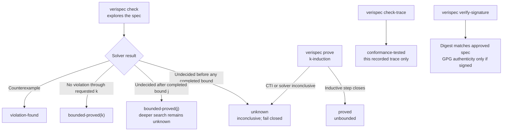

# Guarantees

Every verification result carries a label that says exactly what was
established. There are six verification labels; a result without one has no
clear scope. The MCP `list_invariants` response uses `not-checked` to say
that listing an invariant did not run a check—that is not a guarantee label.

- [The labels](#the-labels)
- [What a label is about](#what-a-label-is-about)
- [What each label proves](#what-each-label-proves)
- [The bounded claim](#the-bounded-claim)
- [Reading a result](#reading-a-result)
- [The false-positive policy](#the-false-positive-policy)
- [How to report a false positive](#how-to-report-a-false-positive)
- [Words to use, and words to avoid](#words-to-use-and-words-to-avoid)

---

## How to read the outcomes



The diagram separates three questions: what the model checker established,
what one observed trace conformed to, and whether the spec still matches its
approved digest.

## The labels

| Label | Emitted by | Status |
| --- | --- | --- |
| `bounded-proved(k)` | `verispec check` | No violation up to depth *k*. |
| `proved` | `verispec prove`, `verispec check --unbounded` | Invariants proved for all depths (k-induction). |
| `bounded-liveness-proved(k)` | `verispec check` (a spec with `temporal:`) | No liveness counterexample (lasso) up to depth *k*. |
| `concurrent-explored(k)` | `verispec check-concurrent` | No violation in any explored interleaving up to *k*. |
| `conformance-tested` | `verispec check-trace`, `verispec monitor` | A recorded run conformed. |
| `pending-obligation` | `verispec check-trace` (a spec with `temporal:`) | The trace conformed, but a temporal obligation is not satisfied at its end. |
| `signature-verified` | `verispec verify-signature` | The spec still matches the digest a human approved. |
| `violation-found` | `verispec check`, `verispec check-trace` | A concrete counterexample exists. |
| `unknown` | `verispec check` | The checker could not decide. |

The same labels appear in the machine-readable output (`--format json`), in
the conformance report, in the counterexample viewer, and in the MCP server
responses. The legend is part of the report format, so a report is
self-describing.

`verispec verify-signature` reports its outcome in a `reason` field rather
than a `guarantee` field: `verified` when a GPG signature is present and
valid, `digest-match` when only the digest matches, and `digest-mismatch`,
`missing-signature` or `gpg-invalid` otherwise. Those reasons are the
`signature-verified` outcome and its failures.

## What a label is about

A label says what was *established*, and every label is also scoped: it is
about the **contract**, about a **recorded trace**, or about a **digest**.

The distinction matters.  `bounded-proved(k)` is a statement about the
contract: it says the contract is consistent up to depth *k*.  It says
nothing about the implementation - that is what `conformance-tested` is for.
A reader who does not know that will read `bounded-proved(8)` as a statement
about the code, which it is not.

The command output says so too, in as many words:

```console
$ verispec check specs/orders.yaml --bound 8
no violation up to bound 8  (bounded claim only, not a proof for all depths;
guarantee: bounded-proved(8); a statement about the contract, not about the implementation)
```

`verispec self-check` audits this: every label is defined in exactly one
place, every label is documented, and every label has a scope.

## What each label proves

### `proved`

**It proves:** the spec **safety invariants** hold on every execution, for any
number of steps. VeriSpec establishes this with *k-induction*: a bounded base
case through depth *k−1*, then an inductive step showing that *k* consecutive
states satisfying the invariants cannot be followed by a violating state.

**It does not prove:** temporal liveness properties (`temporal` / `eventually` /
`leads_to`); use `verispec check` for bounded liveness (`bounded-liveness-proved(k)`).
It does not prove anything about a particular implementation (the proof is over
the *spec* transition system, like bounded checking). It also does not apply
when the inductive step fails to close: then the guarantee is `unknown` and the
tool may report a *counterexample to induction* (states that satisfy the
invariants but whose successor does not). That CTI is a hint to strengthen
invariants, not a runtime bug.

Use `verispec prove SPEC` or `verispec check SPEC --unbounded`.

### `bounded-proved(k)`

**It proves:** no invariant was violated in any execution up to depth *k*.

**It does not prove:** that the invariants hold for all depths. A run of
length 21 can break an invariant that a run of length 20 does not, and the
checker will not tell you that a deeper run is clean. It also does not prove
anything about a particular implementation: the checker explores the *spec*,
not your code.

The *k* is in the label for a reason. A bare `bounded-proved` would be a
claim without a scope.

### `conformance-tested`

**It proves:** a recorded trace of the real implementation was replayed
against the spec and every step conformed. Concretely, for every step: the
state was well formed, the collection capacities held, the invariants held,
the action existed, the parameters matched the declaration, the preconditions
held in the previous state, and the effects produced exactly the recorded
state.

**It does not prove:** anything about the steps that were not recorded, or
about a different run. A trace is a sample, and a sample is evidence about
the implementation, not a proof about it. A trace that happens to miss the
buggy path proves nothing about that path.

The trace that produced the label is part of the evidence: keep it.

### `signature-verified`

**It proves:** the spec still matches the digest that a human approved. If a
GPG signature is present, that signature verifies as well.

**It does not prove:** that the spec is correct, or even that the approver
wrote it. Without a cryptographic signature, the approver field is a
recorded claim, and the verifier says so out loud:

```console
$ verispec verify-signature specs/bank.yaml
OK: spec matches its approved digest (approver: alice). No cryptographic signature: the approver is a recorded claim, not proof.
```

The digest covers the *resolved* spec, so an imported module changing also
breaks the signature. It says nothing about the implementation.

### `violation-found`

**It proves:** a concrete counterexample exists. There is a specific
sequence of actions, with specific parameters, that reaches a state in which
an invariant is false. The counterexample is reproducible: apply those
actions to the implementation and you get the same state.

**It does not prove:** that the implementation is at fault. It proves the
implementation and the spec disagree. Usually that means the implementation
has a bug, and the fix belongs there. Sometimes it means the spec is wrong,
and that is a conversation with a human, not an edit.

### `unknown`

**It proves:** nothing *at the bound it could not decide*. The solver hit its
timeout, or returned something other than `sat` or `unsat`.

**It does not prove:** that the invariants hold, and it does not prove that
they do not. An `unknown` result is an inconclusive result. It is not a
failure and it is not a success; treat it as "no information" at that depth.

The checker deepens the search one bound at a time, so an `unknown` result
still carries what it *did* prove: the shallower bounds were decided. The
message says so, and the guarantee label names the depth that was reached.

```console
$ verispec check specs/orders.yaml --bound 10 --timeout 20000
no violation up to bound 6; the solver could not decide bound 7 (timeout)  (guarantee: bounded-proved(6))
```

Read that as: *the model is clean up to depth 6, and depth 7 is unknown*.
Raise `--timeout`, lower `--bound`, or check one invariant at a time with
`--invariant`, which is often much cheaper.

An `unknown` result exits with code `1`, the same code a violation uses. A
pipeline therefore treats "no information" as a failure, which is the safe
default: an inconclusive check must not be green.

## What a policy can demand

`verispec policy check` is the gate: it reads `.verispec/policy.yaml` and
fails when an entry does not hold.  The level an entry names with
`min_guarantee` is the *evidence* the repository promises, and the policy
runs the same checks the CLI runs — a policy must not be looking at
different evidence than the pipeline.

| `min_guarantee` | What the policy then requires |
| --- | --- |
| `present` | A spec exists and is well formed. |
| `signed-digest` | The spec matches the digest a human approved. |
| `cryptographic` | The digest is signed with a cryptographic key. |
| `bounded-proved` | The safety invariants hold in every execution up to the bound. |
| `proved` | The safety invariants hold in every execution, at every depth. |
| `bounded-liveness-proved` | No liveness counterexample (lasso) up to the bound. |
| `conformance-tested` | A recorded trace of the real implementation conformed. |

The levels are ordered, and a level demands everything below it.  `proved`
demands the unbounded proof: the k-induction has to close, not just the
bounded search.  A contract that cannot be proved can still be required to
be `bounded-proved`, but then the policy says exactly that.

## The bounded claim

The bound is the depth of the search, not a property of the spec.

| Knob | Default | Effect |
| --- | --- | --- |
| `--bound N` | `10` | The maximum number of steps the checker explores. |
| `--timeout MS` | `30000` | The solver timeout per bound, in milliseconds. |
| `--invariant NAME` | all | Restrict the search to one invariant. |

The checker deepens the search one step at a time and stops at the first
bound where a violation exists. That is why the counterexample for the buggy
bank spec is reported "within bound 2" and not "within bound 10": it is the
*shortest* counterexample, which is the most useful one.

A run of bound *k* explores every execution of length up to *k*. It says
nothing about length *k+1*.

Raising the bound makes the claim stronger and the run slower, in a way that
is hard to predict. The bound is not a quality knob you turn up until the
build is green: a green build at bound 10 and a green build at bound 100 are
different claims, and both are bounded.

A collection's `max_size` interacts with the bound: a spec with a sequence of
capacity 4 needs at least 4 steps to overflow it, so a bound of 3 cannot find
that violation. When a check passes, check that the bound is deep enough to
reach the interesting states.

## Reading a result

```console
$ verispec check specs/bank.yaml --bound 10 --format json
{
  "tool": "verispec",
  "version": "1.0.0",
  "command": "check",
  "spec": {
    "name": "Bank",
    "path": "specs/bank.yaml",
    "spec_version": "1.0",
    "digest": "sha256:9b267ba92b5b4c91e8286fed866b4cca1f029ce93734456685f07c82f71b84f1"
  },
  "status": "ok",
  "guarantee": "bounded-proved(10)",
  "bound": 10,
  "message": "no violation up to bound 10",
  "violated": [],
  "violations": [],
  "trace": []
}
```

The fields that carry the meaning:

| Field | What to read it as |
| --- | --- |
| `status` | `ok`, `violation` or `unknown`. |
| `guarantee` | The label. This is the claim. |
| `bound` | The depth the claim covers. |
| `spec.digest` | Which exact spec was checked. |
| `violations` | The violated invariants, with the step and the state. |
| `trace` | The counterexample, step by step. |

The digest matters in CI: it is how you know the result belongs to the spec
you think it belongs to. `verispec sign` records it, and
`verispec verify-signature` checks it.

## The false-positive policy

A false positive is a counterexample that VeriSpec reports but that is not a
real violation of the spec, or a trace that VeriSpec rejects but that is
valid.

**A false positive is a bug in the tool.** It is never a reason to weaken the
spec. The policy is:

1. **Do not edit the spec.** Not the invariant, not the precondition, not the
   bound, not the collection domain. A silent edit hides the bug from
   everybody who reads the spec later, and it destroys the trust the whole
   tool depends on.
2. **Report it.** Use the `False positive` issue template. It asks for the
   exact command, the exact output, the bound, and why the result is
   spurious.
3. **Work around it in the pipeline, not in the spec.** If the false positive
   blocks a release, narrow the scope of the run in the CI configuration, or
   exclude the known case there, and leave the spec alone.
4. **Do not raise the bound to hide it.** A violation found at bound 10 is
   found at bound 10. Raising the bound makes the search deeper, not the
   result different.

The same policy applies to a trace that is rejected but is valid: report it,
do not change the spec to accept the trace.

## How to report a false positive

Open an issue with the `False positive` issue template. It asks for:

| Field | What to put in it |
| --- | --- |
| Spec file | The path to the spec, or a link to it. |
| Counterexample trace | The full output of the run, exactly as printed. |
| Bound used | The `--bound` value. |
| Why this is a false positive | Which part of the result does not correspond to a real violation. |
| Impact | Blocks CI, noise, slow, wrong behaviour downstream, other. |
| Additional context | The exact command, the VeriSpec version, the language and adapter. |

The attestation in the template is the part to read twice: it says that the
spec was not weakened to hide the counterexample, and that the spec is
human-approved. Both are required.

A useful report contains a minimal reproduction: the smallest spec, the
smallest bound, and the exact command. A false positive that cannot be
reproduced cannot be fixed.

While you wait, the classification of a suspected false positive helps:

| Symptom | Usual cause |
| --- | --- |
| The counterexample uses a key or element outside the declared domain. | A bug in the domain encoding, or a spec whose domain is too narrow. |
| The counterexample reaches a state the implementation cannot produce. | A bug in the encoding of the initial state, or a missing precondition. |
| The counterexample violates a capacity bound the implementation never hits. | A `max_size` that is smaller than the implementation's real capacity. |
| The trace is rejected with `effect-mismatch` on a state the implementation really produces. | A default value that differs between the interpreter and the trace checker, or a type coercion in the recorder. |
| The trace is rejected with `precondition` but the precondition did hold. | A type coercion in the recorder (a number that arrives as a string, for example). |

## Words to use, and words to avoid

| Do not write | Write instead |
| --- | --- |
| "The spec is proved." | "No invariant was violated up to bound 10 (`bounded-proved(10)`)." |
| "The implementation is correct." | "The implementation conformed on the recorded trace (`conformance-tested`)." |
| "VeriSpec proved the transfer is safe." | "The checker found no violation of `total_conserved` up to bound 10." |
| "The spec is verified." | "The spec still matches the digest that Alice approved (`signature-verified`)." |
| "The check passed, so there are no bugs." | "The check passed at bound 10. Deeper runs are not covered." |

The word "proved" appears in the unbounded label `proved` and in bounded
`bounded-proved(k)` (which names *k* on purpose). The word "verified" belongs
to the signature check, where it means "the bytes are the bytes that were
approved", and nowhere else.
