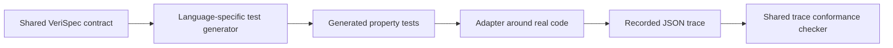

# Language integrations

VeriSpec is language agnostic by design. The spec is verified once, and the
implementation is checked against it from whatever language it is written in.
There is exactly one language-specific piece: the **adapter**.



The spec, result semantics, and trace format stay shared; the adapter is the
seam between VeriSpec and the implementation language.

- [Coverage](#coverage)
- [The contract, in every language](#the-contract-in-every-language)
- [Python](#python)
- [TypeScript](#typescript)
- [Go](#go)
- [Rust](#rust)
- [C](#c)
- [Java and Kotlin](#java-and-kotlin)
- [The trace format, in every language](#the-trace-format-in-every-language)
- [Differential testing between two languages](#differential-testing-between-two-languages)

---

## Coverage

| Language | Generated property tests | Trace recorder and `check-trace` | External harness | Status |
| --- | --- | --- | --- | --- |
| Python | yes, Hypothesis | yes, `verispec.sdk` | - | Covered. |
| TypeScript | yes, fast-check | yes | - | Covered. |
| JavaScript | yes, fast-check | yes | - | Covered; the same test without the type syntax. |
| Go | yes, `testing` | yes | - | Covered. |
| Rust | yes, no external crate | yes | `gen-harness --target kani` | Covered. |
| C | yes, no external crate | yes | `gen-harness --target esbmc` | Covered. |
| Java / Kotlin | jqwik templates | yes | - | Covered; the CLI generator is not wired yet. |

The CLI accepts `--lang python|typescript|javascript|go|rust|c|java`. In this
build the property-test generator is implemented for **Python, TypeScript,
JavaScript, Go, Rust and C**; for Java the generator is not implemented yet, so
`verispec gen-tests specs/bank.yaml --lang java` exits with a spec error. The
trace path (record a JSON trace, replay it with `verispec check-trace`) works
for every language, including the ones without a generator, because a trace
is just JSON.

Rust and C additionally have the external-checker route:
`verispec gen-harness --target kani` emits a Rust harness for Kani and
`--target esbmc` emits a C harness for ESBMC and CBMC. Both are skeletons:
you wire them to the real implementation.

## The contract, in every language

Three methods, and the state is exactly the spec's variables:

| Concept | Python | TypeScript | JavaScript | Go | Rust | C |
| --- | --- | --- | --- | --- | --- | --- |
| Reset | `reset()` | `reset()` | `reset()` | `Reset()` | `reset(&mut self)` | `veri_reset(void)` |
| Apply | `apply(action, **params)` | `apply(action, params)` | `apply(action, params)` | `Apply(action, params)` | `apply(&mut self, action, params)` | `veri_apply(action, params_json)` |
| Snapshot | `snapshot() -> dict` | `snapshot() -> Record<string, any>` | `snapshot()` | `Snapshot() map[string]any` | `snapshot(&self) -> Value` | `veri_snapshot(out, len)` |

The rules that do not change:

- The action names and the parameter names are the ones in the spec, exactly.
- `snapshot()` returns **every** variable of the spec and nothing else.
- A map is an object with stringified keys (`"0"` for the integer key `0`).
- A set and a sequence are arrays.
- A record is an object keyed by field name.
- An enum value is a string.
- `apply` may throw when a precondition does not hold. The generated tests
  only call actions whose preconditions hold, so a throw there is a defect in
  the adapter, not a legitimate outcome.

The full rules are in [`docs/adapter-authoring.md`](adapter-authoring.md).

## Python

### The adapter

```python
# bank_adapter.py
class BankAdapter:
    def reset(self):
        self.state = {"balance_a": 50, "balance_b": 50}

    def apply(self, action, **params):
        amount = params.get("amount", 0)
        if action == "transfer_a_to_b":
            if not (amount > 0 and self.state["balance_a"] >= amount):
                raise ValueError("precondition")
            self.state["balance_a"] -= amount
            self.state["balance_b"] += amount
        elif action == "transfer_b_to_a":
            if not (amount > 0 and self.state["balance_b"] >= amount):
                raise ValueError("precondition")
            self.state["balance_b"] -= amount
            self.state["balance_a"] += amount
        else:
            raise ValueError(action)

    def snapshot(self):
        return dict(self.state)
```

### The generated test

```console
$ verispec gen-tests specs/bank.yaml --lang python -o tests/test_bank_verispec.py
wrote python tests to tests/test_bank_verispec.py
```

The generated test uses Hypothesis and the VeriSpec runtime itself to compute
the expected state, so there is no second implementation of the semantics to
keep in sync.

Point it at the adapter in one of two ways.

Environment variable, no code change:

```console
$ VERISPEC_ADAPTER=bank_adapter:BankAdapter pytest -q tests/test_bank_verispec.py
.                                                                        [100%]
1 passed in 2.03s
```

Or set the factory in the test module:

```python
# tests/conftest.py or the generated file itself
ADAPTER_FACTORY = BankAdapter
```

The value is a `module:Class` string; the class is instantiated with no
arguments, so it must be constructible with a default constructor.

### The trace recorder

The Python SDK ships with the tool:

```python
from verispec.model import load_spec
from verispec.sdk import TraceRecorder

spec = load_spec("specs/bank.yaml")
recorder = TraceRecorder(spec, adapter=BankAdapter())
recorder.reset()
recorder.apply("transfer_a_to_b", amount=20)
recorder.write("trace.json")
```

`TraceRecorder` calls the adapter and records the state after every step, so
the trace cannot drift from what the implementation did. `record_trace` is
the one-shot form:

```python
from verispec.sdk import record_trace

steps = record_trace(spec, BankAdapter(), [("transfer_a_to_b", {"amount": 20})])
```

The same recorder, written by hand, for the other languages:

```python
import json

class TraceRecorder:
    def __init__(self, adapter):
        self.adapter = adapter
        self.steps = []

    def run(self, actions):
        self.adapter.reset()
        self.steps.append({"action": "init", "params": {}, "state": self.adapter.snapshot()})
        for action, params in actions:
            self.adapter.apply(action, **params)
            self.steps.append({"action": action, "params": params, "state": self.adapter.snapshot()})

    def save(self, path):
        with open(path, "w") as f:
            json.dump(self.steps, f, indent=2)
```

```console
$ verispec check-trace specs/bank.yaml trace.json
trace OK: 3 steps conform to spec Bank
```

## TypeScript

### The adapter

```typescript
// adapter.ts
export function makeAdapter(): Adapter {
  let state: any;
  return {
    reset(): void {
      state = { balance_a: 50, balance_b: 50 };
    },
    apply(action: string, params: Record<string, any>): void {
      const amount = params["amount"] ?? 0;
      if (action === "transfer_a_to_b") {
        if (!(amount > 0 && state["balance_a"] >= amount)) throw new Error("precondition");
        state["balance_a"] -= amount;
        state["balance_b"] += amount;
      } else if (action === "transfer_b_to_a") {
        if (!(amount > 0 && state["balance_b"] >= amount)) throw new Error("precondition");
        state["balance_b"] -= amount;
        state["balance_a"] += amount;
      } else {
        throw new Error(action);
      }
    },
    snapshot(): Record<string, any> {
      return JSON.parse(JSON.stringify(state));
    },
  };
}
```

### The generated test

```console
$ npm install --save-dev fast-check
$ verispec gen-tests specs/bank.yaml --lang typescript -o tests/bank.verispec.gen.ts
wrote typescript tests to tests/bank.verispec.gen.ts
```

The generated module exports `runConformance(makeAdapter)`. It does not
register a test on its own, so you add a two-line test file that wires it to
your runner:

```typescript
// tests/bank.verispec.test.ts
import { test } from 'vitest';
import { runConformance } from './bank.verispec.gen';
import { makeAdapter } from '../adapter';

test('verispec conformance', () => {
  runConformance(makeAdapter);
});
```

```console
$ npx vitest run
```

`--adapter ./adapter` adds `import { makeAdapter } from "./adapter"` to the
generated file. Use it when you want the import in place, and call
`runConformance(makeAdapter)` from your own test file.

The generated file transpiles the spec expressions to TypeScript from the same
AST the Z3 checker uses, so the expected behaviour in the test is the
behaviour in the spec, not a re-reading of the YAML.

### The trace recorder

```typescript
import { writeFileSync } from 'fs';

export function recordTrace(adapter: any, actions: Array<[string, Record<string, any>]>, path: string) {
  const steps: any[] = [];
  adapter.reset();
  steps.push({ action: 'init', params: {}, state: adapter.snapshot() });
  for (const [action, params] of actions) {
    adapter.apply(action, params);
    steps.push({ action, params, state: adapter.snapshot() });
  }
  writeFileSync(path, JSON.stringify(steps, null, 2));
}
```

## JavaScript

JavaScript is the same adapter as TypeScript, without the types. The SDK
ships both an ESM and a CommonJS build, so a plain JavaScript project can
`import` it or `require` it.

### The generated test

```console
$ npm install --save-dev fast-check
$ verispec gen-tests specs/bank.yaml --lang javascript -o tests/bank.verispec.gen.js
wrote javascript tests to tests/bank.verispec.gen.js
```

The generated file is the TypeScript one without the type syntax: the same
expressions, transpiled from the same AST, the same runtime helpers, the same
`runConformance(makeAdapter)` entry point. The types travel as JSDoc, so your
editor still knows what `state` and `params` are.

```javascript
// tests/bank.verispec.test.js
import { test } from 'node:test';
import { runConformance } from './bank.verispec.gen.js';
import { makeAdapter } from '../adapter.js';

test('verispec conformance', () => {
  runConformance(makeAdapter);
});
```

The generated file is an ES module. In a CommonJS project, either name it
`.mjs`, set `"type": "module"` in your `package.json`, or use the TypeScript
generator.

### The trace recorder

```javascript
import { TraceRecorder } from '@verispec/adapter';

const recorder = new TraceRecorder(makeAdapter());
recorder.reset();
recorder.apply('transfer_a_to_b', { amount: 20 });
recorder.write('traces/session.json');
```

From CommonJS:

```javascript
const { TraceRecorder } = require('@verispec/adapter');
```

## Go

### The adapter

The Go adapter uses exported method names, because the generated test lives in
a different package:

```go
// bank/adapter.go
package bank

type Adapter struct {
	state map[string]any
}

func NewAdapter() *Adapter {
	return &Adapter{state: map[string]any{}}
}

func (a *Adapter) Reset() {
	a.state = map[string]any{"balance_a": 50, "balance_b": 50}
}

func (a *Adapter) Apply(action string, params map[string]any) {
	amount := params["amount"].(int)
	switch action {
	case "transfer_a_to_b":
		if !(amount > 0 && a.state["balance_a"].(int) >= amount) {
			panic("precondition")
		}
		a.state["balance_a"] = a.state["balance_a"].(int) - amount
		a.state["balance_b"] = a.state["balance_b"].(int) + amount
	case "transfer_b_to_a":
		if !(amount > 0 && a.state["balance_b"].(int) >= amount) {
			panic("precondition")
		}
		a.state["balance_b"] = a.state["balance_b"].(int) - amount
		a.state["balance_a"] = a.state["balance_a"].(int) + amount
	default:
		panic(action)
	}
}

func (a *Adapter) Snapshot() map[string]any {
	out := map[string]any{}
	for k, v := range a.state {
		out[k] = v
	}
	return out
}
```

The generated test builds the adapter as `&bank.BankAdapter{}`, so the struct
must be constructible with no arguments and must not need initialisation
before `Reset` is called.

### The generated test

```console
$ verispec gen-tests specs/bank.yaml --lang go --package verispec_conformance \
    --adapter ./bank.BankAdapter -o conformance/bank_verispec_test.go
wrote go tests to conformance/bank_verispec_test.go
```

| Flag | Meaning |
| --- | --- |
| `--package` | The package name of the generated file. Default `verispec_conformance`. |
| `--adapter` | `path.Type`. The generated file imports it and builds it. |

The generated file contains a `TestVeriSpecConformance` function, so it runs
with the standard runner:

```console
$ go test ./conformance/...
```

The generated test uses the standard library `testing` package and
`math/rand`; there is no third-party dependency.

### The trace recorder

```go
package bank

import (
	"encoding/json"
	"os"
)

type Step struct {
	Action string         `json:"action"`
	Params map[string]any `json:"params"`
	State  map[string]any `json:"state"`
}

func RecordTrace(a *Adapter, actions []struct {
	Name   string
	Params map[string]any
}, path string) error {
	steps := []Step{}
	a.Reset()
	steps = append(steps, Step{Action: "init", Params: map[string]any{}, State: a.Snapshot()})
	for _, act := range actions {
		a.Apply(act.Name, act.Params)
		steps = append(steps, Step{Action: act.Name, Params: act.Params, State: a.Snapshot()})
	}
	data, err := json.MarshalIndent(steps, "", "  ")
	if err != nil {
		return err
	}
	return os.WriteFile(path, data, 0o644)
}
```

## Rust

### The adapter

Rust has no keyword arguments, so `apply` takes a map. The generated test
expects the `verispec_adapter` crate and the `VeriSpecAdapter` trait:

```rust
// src/adapter.rs
use std::collections::HashMap;
use serde_json::Value;

pub trait VeriSpecAdapter {
    fn reset(&mut self);
    fn apply(&mut self, action: &str, params: &HashMap<String, Value>);
    fn snapshot(&self) -> Value;   // a JSON object with exactly the spec's variables
}

pub struct BankAdapter {
    balance_a: i64,
    balance_b: i64,
}

impl VeriSpecAdapter for BankAdapter {
    fn reset(&mut self) {
        self.balance_a = 50;
        self.balance_b = 50;
    }

    fn apply(&mut self, action: &str, params: &HashMap<String, Value>) {
        let amount = params.get("amount").and_then(|v| v.as_i64()).unwrap_or(0);
        match action {
            "transfer_a_to_b" => {
                assert!(amount > 0 && self.balance_a >= amount, "precondition");
                self.balance_a -= amount;
                self.balance_b += amount;
            }
            "transfer_b_to_a" => {
                assert!(amount > 0 && self.balance_b >= amount, "precondition");
                self.balance_b -= amount;
                self.balance_a += amount;
            }
            other => panic!("unknown action {other}"),
        }
    }

    fn snapshot(&self) -> Value {
        serde_json::json!({ "balance_a": self.balance_a, "balance_b": self.balance_b })
    }
}
```

### The generated test

```console
$ verispec gen-tests specs/bank.yaml --lang rust --adapter mycrate::MyAdapter -o tests/verispec_conformance.rs
wrote rust tests to tests/verispec_conformance.rs
```

The generated file:

- uses a deterministic 64-bit LCG, so a failing run is reproducible and no
  extra crate and no clock are needed,
- transpiles the spec expressions from the same AST the Z3 checker uses,
- declares `veri_make_adapter()`, which you fill in:

```rust
pub fn veri_make_adapter() -> Box<dyn VeriSpecAdapter> {
    Box::new(MyAdapter::new())
}
```

- registers a `#[test] fn verispec_conformance()`.

```console
$ cargo test --test verispec_conformance
```

The generated file needs `serde_json` and the `verispec_adapter` crate. The
adapter is expected to be constructible with no arguments.

### The trace recorder

```rust
// tests/trace.rs
use serde_json::json;
use std::collections::HashMap;

#[test]
fn records_a_conforming_trace() {
    let mut adapter = BankAdapter::new();
    adapter.reset();
    let mut steps = vec![json!({
        "action": "init",
        "params": {},
        "state": adapter.snapshot(),
    })];

    let mut params = HashMap::new();
    params.insert("amount".to_string(), json!(20));
    adapter.apply("transfer_a_to_b", &params);
    steps.push(json!({
        "action": "transfer_a_to_b",
        "params": { "amount": 20 },
        "state": adapter.snapshot(),
    }));

    std::fs::write("trace.json", serde_json::to_string_pretty(&steps).unwrap()).unwrap();
}
```

```console
$ cargo test --test trace
$ verispec check-trace specs/bank.yaml trace.json
trace OK: 2 steps conform to spec Bank
```

### The Kani harness

```console
$ verispec gen-harness specs/bank.yaml --target kani -o src/bank_kani.rs
wrote kani harness to src/bank_kani.rs
```

The harness is a skeleton: it declares the nondeterministic state and asserts
the invariants. Wire `init_state` and the action functions to the real
implementation, then run it with `cargo kani`.

## C

### The adapter

The generated C test expects three functions in `verispec.h`, and it passes
the parameters as a JSON string:

```c
/* verispec.h */
#ifndef VERISPEC_H
#define VERISPEC_H

#include <stddef.h>

/* Put the implementation in the initial state of the spec. */
void veri_reset(void);

/* Apply one action.  params_json is a JSON object with the action's
 * parameters, for example {"amount": 20}. */
void veri_apply(const char *action, const char *params_json);

/* Write the current state as a JSON object with exactly the spec's
 * variables, for example {"balance_a":50,"balance_b":50}. */
void veri_snapshot(char *out, size_t out_len);

#endif
```

The implementation behind them is yours:

```c
/* bank.c */
#include "verispec.h"
#include <stdio.h>
#include <string.h>
#include <stdlib.h>

static long long balance_a = 50;
static long long balance_b = 50;

void veri_reset(void) {
    balance_a = 50;
    balance_b = 50;
}

void veri_apply(const char *action, const char *params_json) {
    long long amount = 0;
    const char *at = params_json ? strstr(params_json, "amount") : NULL;
    if (at) {
        at = strchr(at, ':');
        if (at) amount = strtoll(at + 1, NULL, 10);
    }
    if (strcmp(action, "transfer_a_to_b") == 0) {
        if (!(amount > 0 && balance_a >= amount)) { fprintf(stderr, "precondition\n"); exit(1); }
        balance_a -= amount;
        balance_b += amount;
    } else if (strcmp(action, "transfer_b_to_a") == 0) {
        if (!(amount > 0 && balance_b >= amount)) { fprintf(stderr, "precondition\n"); exit(1); }
        balance_b -= amount;
        balance_a += amount;
    } else {
        fprintf(stderr, "unknown action %s\n", action);
        exit(1);
    }
}

void veri_snapshot(char *out, size_t out_len) {
    snprintf(out, out_len, "{\"balance_a\":%lld,\"balance_b\":%lld}", balance_a, balance_b);
}
```

A real implementation will want a JSON parser instead of `strstr`, but the
contract is the contract: the snapshot is a JSON object with exactly the
spec's variables.

### The generated test

```console
$ verispec gen-tests specs/bank.yaml --lang c -o conformance/verispec_conformance.c
wrote c tests to conformance/verispec_conformance.c
```

The generated file:

- uses a deterministic 64-bit LCG, so a failing run is reproducible,
- transpiles the spec expressions from the same AST the Z3 checker uses,
- declares a default `veri_make_adapter()` that does nothing, so the
  conformance run calls `veri_reset()` before it uses the adapter. If your
  adapter needs a setup step, edit that body. If you provide your own
  `veri_make_adapter()` in another translation unit, compile the generated
  file with `-DVERISPEC_NO_DEFAULT_FACTORY` so the two do not clash,
- has a `main()` that drives the adapter and reports the first mismatch on
  stderr.

```console
$ cc -I../include -o conformance/verispec_conformance \
      conformance/verispec_conformance.c ../src/verispec.c bank.c
$ ./conformance/verispec_conformance
```

The C adapter supports **scalar specs only**. A spec with a map, a set, a
sequence or a record is rejected with a clear error, because the C runtime
has no representation for them yet.

The generated C code needs the VeriSpec C runtime (`include/verispec.h` and
`src/verispec.c` from `adapters/c/`) at link time: the runtime holds the JSON
codec and the `veri_*` helpers. The runtime has no external dependency, so
the only thing to add to a build is one header and one source file.

### The trace recorder

```c
/* trace.c */
void record_step(FILE *out, const char *action, const char *params_json, const bank_state_t *s) {
    char state[256];
    bank_snapshot_json(s, state, sizeof(state));
    if (strcmp(action, "init") == 0) {
        fprintf(out, "  {\"action\": \"init\", \"params\": {}, \"state\": %s},\n", state);
    } else {
        fprintf(out, "  {\"action\": \"%s\", \"params\": %s, \"state\": %s},\n",
                action, params_json, state);
    }
}
```

### The ESBMC / CBMC harness

```console
$ verispec gen-harness specs/bank.yaml --target esbmc -o harness.c
wrote esbmc harness to harness.c
```

The harness declares a `state_t` with the spec's variables, marks them
nondeterministic, and asserts the invariants with `__ESBMC_assert`. Wire the
struct and the action functions to the real implementation, then run it with
`esbmc harness.c` or `cbmc harness.c`.

## Java and Kotlin

The property-test generator for Java is not implemented in this build. The
trace path is.

### The adapter

```java
// BankAdapter.java
import java.util.LinkedHashMap;
import java.util.Map;

public final class BankAdapter {
    private long balanceA = 50;
    private long balanceB = 50;

    public void reset() {
        balanceA = 50;
        balanceB = 50;
    }

    public void apply(String action, Map<String, Object> params) {
        long amount = ((Number) params.getOrDefault("amount", 0)).longValue();
        switch (action) {
            case "transfer_a_to_b" -> {
                if (!(amount > 0 && balanceA >= amount)) throw new IllegalStateException("precondition");
                balanceA -= amount;
                balanceB += amount;
            }
            case "transfer_b_to_a" -> {
                if (!(amount > 0 && balanceB >= amount)) throw new IllegalStateException("precondition");
                balanceB -= amount;
                balanceA += amount;
            }
            default -> throw new IllegalArgumentException(action);
        }
    }

    public Map<String, Object> snapshot() {
        Map<String, Object> out = new LinkedHashMap<>();
        out.put("balance_a", balanceA);
        out.put("balance_b", balanceB);
        return out;
    }
}
```

Kotlin is the same shape, with `MutableMap<String, Any>` instead of
`Map<String, Object>` and `when` instead of `switch`.

### The trace recorder

```java
// TraceRecorder.java
import com.fasterxml.jackson.databind.ObjectMapper;
import java.io.IOException;
import java.util.ArrayList;
import java.util.LinkedHashMap;
import java.util.List;
import java.util.Map;

public final class TraceRecorder {
    private final BankAdapter adapter;
    private final List<Map<String, Object>> steps = new ArrayList<>();

    public TraceRecorder(BankAdapter adapter) {
        this.adapter = adapter;
    }

    public void reset() {
        adapter.reset();
        steps.add(step("init", Map.of(), adapter.snapshot()));
    }

    public void apply(String action, Map<String, Object> params) {
        adapter.apply(action, params);
        steps.add(step(action, params, adapter.snapshot()));
    }

    public void save(String path) throws IOException {
        new ObjectMapper().writerWithDefaultPrettyPrinter().writeValue(new java.io.File(path), steps);
    }

    private static Map<String, Object> step(String action, Map<String, Object> params, Map<String, Object> state) {
        Map<String, Object> out = new LinkedHashMap<>();
        out.put("action", action);
        out.put("params", params);
        out.put("state", state);
        return out;
    }
}
```

Without Jackson, write the JSON by hand: it is three fields per step, and
the escaping rules for the supported value types are trivial.

## The same API in three languages

[`examples/orders-api/`](../examples/orders-api/) implements the same REST
API, with the same database and the same business rules, three times: in
Python (FastAPI + SQLite), in TypeScript (`node:http` + `node:sqlite`) and in
Go (`net/http` + SQLite).  All three obey **one** spec
(`orders.verispec.yaml`), and the three recorded traces are byte-identical.

It is the worked example of everything in this document: the adapter
contract, the generated conformance test, the trace recorder and the
differential comparison.

## The trace format, in every language

Whatever language you record a trace in, the file is the same JSON:

```json
[
  {"action": "init", "params": {}, "state": {"balance_a": 50, "balance_b": 50}},
  {"action": "transfer_a_to_b", "params": {"amount": 20}, "state": {"balance_a": 30, "balance_b": 70}}
]
```

| Spec type | JSON | Notes |
| --- | --- | --- |
| `int` | number | Not a string. |
| `bool` | `true` / `false` | Not `"true"`. |
| `str` | string | |
| `enum[...]` | string | One of the enum values. |
| `map` | object | Keys are **stringified**: `{"0": 10}`. |
| `set` | array | Order does not matter for the checker. |
| `seq` | array | Order matters. |
| `record` | object | Keyed by field name. |

## Differential testing between two languages

When two implementations of the same spec exist (a rewrite, a second
implementation, a port), record the same action sequence in both and compare
the traces:

```console
$ verispec diff-trace traces/python.json traces/rust.json
the traces diverge at step 1: different state in ['balance_b']
```

The exit code is `1` when the traces differ. This is the same mechanism as
the differential oracle described in ADR-0007; today it compares recorded
traces rather than exploring both implementations itself.

Note the direction of the evidence: a divergence is a fact about the two
traces, and it does not by itself say which side is wrong. Check both against
the spec with `verispec check-trace`, and the spec decides.
