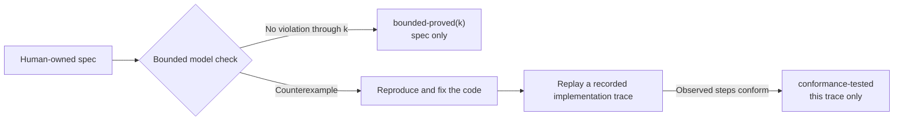

# VeriSpec in 15 minutes

A hands-on tutorial. By the end of it you will have written a spec, checked
it, found a bug in an implementation with a counterexample, fixed the
implementation, and checked a recorded run for conformance. A trace is
evidence about that run—not a proof that every execution is correct.

The clock is a guide, not a deadline. Each section says what you should be
able to do when it ends.

| Section | Clock | You will |
| --- | --- | --- |
| [1. Install and validate](#1-install-and-validate) | 0:00 - 2:00 | Load a spec and read the verdict. |
| [2. Read the contract](#2-read-the-contract) | 2:00 - 4:00 | Say what the spec promises. |
| [3. Lint the spec](#3-lint-the-spec) | 4:00 - 5:00 | Know whether the spec can fail at all. |
| [4. Check the good spec](#4-check-the-good-spec) | 5:00 - 7:00 | State a bounded claim, honestly. |
| [5. Find the bug](#5-find-the-bug) | 7:00 - 10:00 | Produce a counterexample. |
| [6. Fix the implementation](#6-fix-the-implementation) | 10:00 - 13:00 | Repair the code, not the spec. |
| [7. Record a trace](#7-record-a-trace) | 13:00 - 15:00 | Prove the fix conforms. |

Everything below uses the `bank` example that ships with the repository.



The model checker explores the spec. Trace checking observes a particular
implementation run. Neither result covers every possible execution.

---

## 1. Install and validate

**Clock: 0:00 - 2:00.**

Install the tool:

```bash
pip install -e ".[test]"
```

Check that it is there:

```console
$ verispec version
verispec 1.0.0
```

Now validate the good spec:

```console
$ verispec validate examples/bank.yaml
OK: spec Bank valid (2 vars, 2 actions, 2 invariants)
```

That single line means three things: the YAML parses, every expression type
checks, and every name in `init`, `effects` and `invariants` exists. If
something is wrong, the tool says exactly what and exits with code `2`:

```console
$ verispec validate broken.yaml
error: action transfer effect assigns unknown var 'balnace'
```

A spec you cannot validate is a spec you cannot check. Fix the spec before
moving on.

## 2. Read the contract

**Clock: 2:00 - 4:00.**

Open `examples/bank.yaml`:

```yaml
spec_version: "1.0"
name: Bank
description: >
  Two accounts A and B.  Transfers conserve the total and no account may go
  negative.  The canonical demo spec: the buggy variant shows what VeriSpec
  catches in two steps.
vars:
  balance_a: {type: int, min: 0, max: 100}
  balance_b: {type: int, min: 0, max: 100}
init:
  balance_a: "50"
  balance_b: "50"
actions:
  - name: transfer_a_to_b
    params:
      amount: {type: int, min: 1, max: 50}
    requires: ["amount > 0", "balance_a >= amount"]
    effects:
      balance_a: "balance_a - amount"
      balance_b: "balance_b + amount"
  - name: transfer_b_to_a
    params:
      amount: {type: int, min: 1, max: 50}
    requires: ["amount > 0", "balance_b >= amount"]
    effects:
      balance_b: "balance_b - amount"
      balance_a: "balance_a + amount"
invariants:
  - {name: total_conserved, expr: "balance_a + balance_b == 100"}
  - {name: non_negative, expr: "balance_a >= 0 and balance_b >= 0"}
```

Read it as plain language:

- There are two accounts, `balance_a` and `balance_b`, each an integer.
- Both start at 50.
- `transfer_a_to_b` moves `amount` from A to B. It is only allowed when A can
  cover the amount.
- `transfer_b_to_a` is the mirror image.
- **Always**: the two balances add up to 100, and neither goes negative.

Those last two lines are the contract. Everything else in this tutorial is
about proving that an implementation keeps them.

## 3. Lint the spec

**Clock: 4:00 - 5:00.**

A verified spec is only as good as the spec. The linter looks for specs that
cannot fail:

```console
$ verispec lint examples/bank.yaml
OK: spec Bank has no lint findings
0 error(s), 0 warning(s), 0 info
```

The linter reports tautological invariants, actions whose preconditions can
never hold, actions that change nothing, and state variables with no bounds.
It also tells you when a spec is still in the old format:

```console
$ verispec lint examples/link-queue.yaml
INFO: no-spec-version: no spec_version field: the spec is treated as format v0.1; run `verispec migrate` to move it to v1.0
0 error(s), 0 warning(s), 1 info
```

## 4. Check the good spec

**Clock: 5:00 - 7:00.**

```console
$ verispec check examples/bank.yaml --bound 10
no violation up to bound 10  (bounded claim only, not a proof for all depths; guarantee: bounded-proved(10))
```

Read the whole line, not just the first part. It says:

- No invariant was violated in any execution up to 10 steps.
- This is a **bounded** claim. It is not a proof for all depths, and the
  guarantee label is `bounded-proved(10)`, not `proved`.

If you need the machine-readable form, ask for JSON:

```console
$ verispec check examples/bank.yaml --bound 10 --format json
{
  "tool": "verispec",
  "version": "1.0.0",
  "command": "check",
  "spec": {
    "name": "Bank",
    "path": "examples/bank.yaml",
    "spec_version": "1.0",
    "digest": "sha256:9b267ba92b5b4c91e8286fed866b4cca1f029ce93734456685f07c82f71b84f1"
  },
  "status": "ok",
  "guarantee": "bounded-proved(10)",
  "bound": 10,
  "message": "no violation up to bound 10",
  "violated": [],
  "violations": [],
  "trace": []
}
```

The `digest` is the fingerprint of the resolved spec. It is what
`verispec sign` records and what `verispec verify-signature` checks.

## 5. Find the bug

**Clock: 7:00 - 10:00.**

Now the interesting part. `examples/bank-buggy.yaml` is the same contract with
one precondition removed:

```yaml
  - name: transfer_a_to_b
    params:
      amount: {type: int, min: 1, max: 50}
    requires: ["amount > 0"]          # <-- "balance_a >= amount" is gone
    effects:
      balance_a: "balance_a - amount"
      balance_b: "balance_b + amount"
```

The invariants are unchanged. Check it:

```console
$ verispec check examples/bank-buggy.yaml --bound 10
COUNTEREXAMPLE found within bound 2: invariant(s) violated: non_negative
  step 0: state={'balance_a': 50, 'balance_b': 50}
    -> action transfer_a_to_b params={'amount': 1}
  step 1: state={'balance_a': 49, 'balance_b': 51}
    -> action transfer_a_to_b params={'amount': 50}
  step 2: state={'balance_a': -1, 'balance_b': 101}
  violated at step 2: non_negative (invariant) balance_a >= 0 and balance_b >= 0
  This is a counterexample: reproduce it, fix the implementation, re-run. Do not weaken the spec.
```

**You have a counterexample.** It is a concrete, reproducible sequence:

1. Start at `{balance_a: 50, balance_b: 50}`.
2. Transfer 1 from A to B -> `{49, 51}`.
3. Transfer 50 from A to B -> `{-1, 101}`.
4. `balance_a` is now `-1`, so `non_negative` is false.

The exit code is `1` (a violation was found), not `0`. Write that down: in CI,
`1` is a red build.

Note what the trace does **not** contain: the `total_conserved` invariant still
holds at every step, because the buggy spec still moves the same amount. Only
the non-negativity check is missing.

### See it in a browser

```console
$ verispec view examples/bank-buggy.yaml -o counterexample.html --bound 10
wrote counterexample view to counterexample.html
```

`counterexample.html` is a single self-contained file with the violated
invariant, the step, and the full trace. Open it in a browser, or upload it as
a CI artifact.

## 6. Fix the implementation

**Clock: 10:00 - 13:00.**

A counterexample is a statement about the *implementation*, not about the
spec. The spec said "no account may go negative" and the implementation can
make it negative. The fix belongs in the code.

The implementation under test is the **adapter**: a tiny object with three
methods that expose your real code to VeriSpec.

```python
# examples/bank_adapter.py
class BankAdapter:
    def reset(self):
        self.state = {"balance_a": 50, "balance_b": 50}

    def apply(self, action, **params):
        amount = params.get("amount", 0)
        if action == "transfer_a_to_b":
            if not (amount > 0 and self.state["balance_a"] >= amount):
                raise ValueError("precondition")
            self.state["balance_a"] -= amount
            self.state["balance_b"] += amount
        elif action == "transfer_b_to_a":
            if not (amount > 0 and self.state["balance_b"] >= amount):
                raise ValueError("precondition")
            self.state["balance_b"] -= amount
            self.state["balance_a"] += amount
        else:
            raise ValueError(action)

    def snapshot(self):
        return dict(self.state)
```

Three methods, and that is the whole contract:

| Method | Meaning |
| --- | --- |
| `reset()` | Put the implementation in the spec's initial state. |
| `apply(action, **params)` | Apply one action from the spec. |
| `snapshot() -> dict` | The current state, with exactly the spec's variables. |

Now generate the property tests for that adapter:

```console
$ verispec gen-tests examples/bank.yaml --lang python -o test_bank_verispec.py
wrote python tests to test_bank_verispec.py
```

Run them against the correct adapter:

```console
$ VERISPEC_ADAPTER=bank_adapter:BankAdapter PYTHONPATH=examples pytest -q test_bank_verispec.py
.                                                                        [100%]
1 passed in 2.03s
```

And against the buggy one:

```console
$ VERISPEC_ADAPTER=bank_adapter_buggy:BankAdapterBuggy PYTHONPATH=examples pytest -q test_bank_verispec.py
E           AssertionError: step 0 action transfer_a_to_b {'amount': 1}: expected effects {'balance_a': 49, 'balance_b': 51}, got {'balance_a': 49, 'balance_b': 50} (prev={'balance_a': 50, 'balance_b': 50})
=========================== short test summary info ============================
FAILED test_bank_verispec.py::test_verispec_conformance - Assertion...
1 failed in 0.67s
```

The generated test drives the adapter with random but valid action sequences
and compares the resulting state with what the spec says the state should be.
The buggy adapter leaks one unit on every transfer, and the test catches it
on the first step.

To fix it, change the adapter so it enforces the precondition the spec
declares, exactly as `bank_adapter.py` does. Then the generated test passes
again.

The rule is absolute: **never weaken the spec to make a test pass.** If the
counterexample is real, the spec is right and the code is wrong. If you
believe the spec is wrong, stop and take it to a human.

## 7. Record a trace

**Clock: 13:00 - 15:00.**

The generated tests run inside one process. A **trace** is the record of what
your implementation did in a real run, so that a third party (CI, a reviewer,
a colleague) can replay it against the spec.

A trace is a JSON list of steps:

```json
[
  {"action": "init", "params": {}, "state": {"balance_a": 50, "balance_b": 50}},
  {"action": "transfer_a_to_b", "params": {"amount": 20}, "state": {"balance_a": 30, "balance_b": 70}},
  {"action": "transfer_b_to_a", "params": {"amount": 10}, "state": {"balance_a": 40, "balance_b": 60}}
]
```

The first entry has `"action": "init"`. Every entry carries the full state.
Maps are JSON objects with stringified keys, sets and sequences are JSON
arrays, records are JSON objects keyed by field name.

Check the trace that ships with the example:

```console
$ verispec check-trace examples/bank.yaml examples/traces/bank-valid.json
trace OK: 3 steps conform to spec Bank
```

And a trace that does not conform:

```console
$ verispec check-trace examples/bank.yaml examples/traces/bank-invalid.json
step 1: invariant violated: total_conserved (balance_a + balance_b == 100) in state {'balance_a': 30, 'balance_b': 71}
```

The second one fails at step 1, and it says exactly which invariant broke and
what the state was. Exit code `1`.

To record a trace from your own implementation, wrap each action:

```python
import json

trace = []

def record(action, params, state):
    trace.append({"action": action, "params": params, "state": state})

adapter.reset()
record("init", {}, adapter.snapshot())
adapter.apply("transfer_a_to_b", amount=20)
record("transfer_a_to_b", {"amount": 20}, adapter.snapshot())

with open("trace.json", "w") as f:
    json.dump(trace, f, indent=2)
```

Then:

```console
$ verispec check-trace examples/bank.yaml trace.json
trace OK: 2 steps conform to spec Bank
```

The guarantee label for that result is `conformance-tested`: a recorded trace
of the real implementation was replayed against the spec and every step
conformed. It says nothing about the executions that were not recorded.

## Where to go next

If the bank example feels too small, look at
[`examples/orders-api/`](../examples/orders-api/): a REST API with a
database and real business rules, implemented three times (Python,
TypeScript and Go) against **one** spec.  It is the whole workflow in one
directory: the contract, the adapters, the generated conformance tests, the
recorded traces and the differential comparison between the
implementations.

| Goal | Command |
| --- | --- |
| Start a spec of your own | `verispec init myproject --template ledger --lang python` |
| A machine-readable result for CI | `verispec check spec.yaml --format json` |
| SARIF for code scanning | `verispec check spec.yaml --format sarif` |
| A conformance report page | `verispec report spec.yaml -o report.html` |
| A TLA+ module to run with TLC | `verispec export-tla spec.yaml -o Spec.tla` |
| A Lean 4 skeleton of the invariants | `verispec export-lean spec.yaml -o Spec.lean` |
| A brief for a coding agent | `verispec brief spec.yaml -o brief.md` |
| Tests for another language | `verispec gen-tests spec.yaml --lang typescript -o spec.test.ts` |
| An agent that can call the checker | `verispec mcp` |

`verispec init` scaffolds a spec, an adapter and a README from a template,
which is the fastest way to start your own:

```console
$ verispec init myproject --template ledger --lang python
wrote myproject/ledger.verispec.yaml
wrote myproject/adapter_ledger.py
wrote myproject/README.md
```

The full reference is in [`docs/spec-format.md`](spec-format.md). The
guarantee labels are explained in [`docs/guarantees.md`](guarantees.md). The
CI recipes are in [`docs/ci.md`](ci.md).
